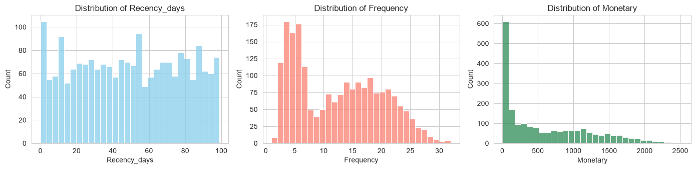
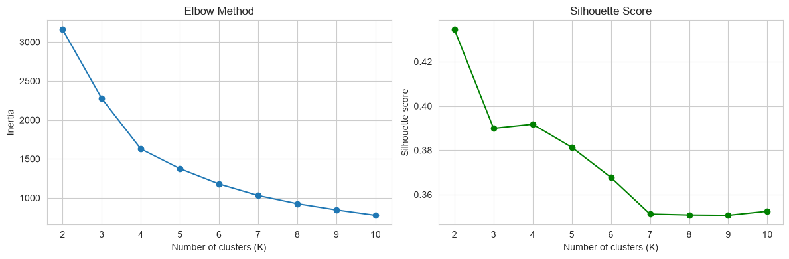
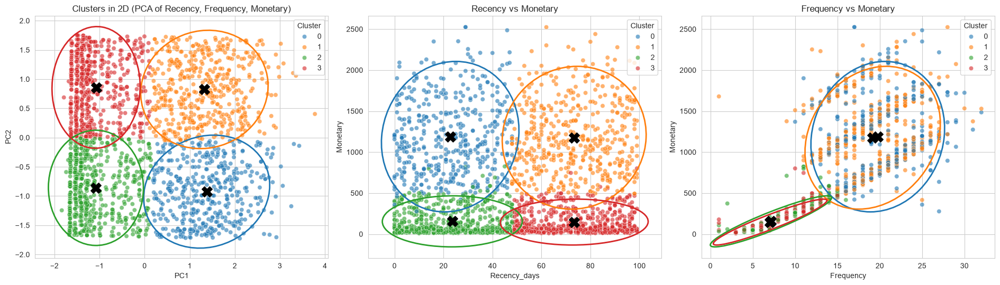
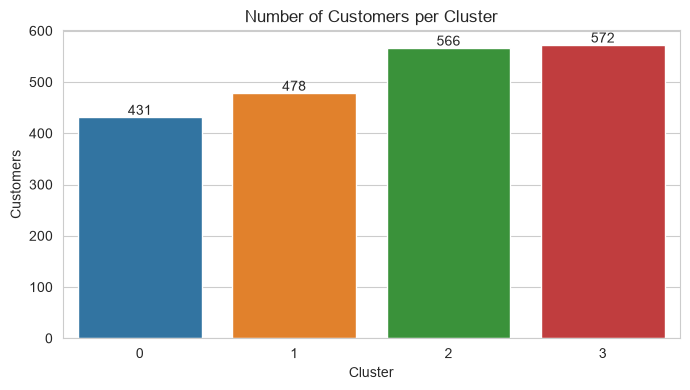
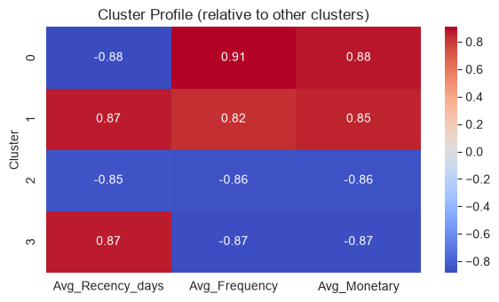

# Customer Segmentation Analysis

**Track:** Data Analytics | **Level 1 - Customer Segmentation Analysis**
**Intern:** Mansi Devganiya | Oasis Infobyte SIP

## Project Overview
This project groups customers into distinct segments based on their purchasing behaviour, using RFM analysis (Recency, Frequency, Monetary) and K-Means clustering. A marketing action is recommended for each segment.

## Dataset
- **Source:** Customer Personality Analysis (Kaggle)
- **Size:** 2,240 customers, 29 columns (tab-separated file)
- **Used for clustering:** Recency, Frequency, Monetary
- **Note:** Each customer has only one row, so Frequency (total web, catalogue and store purchases) and Monetary (total spend on six product categories over 2 years) are built from summary columns and not from individual invoices. The 2-year spend is used as a simple proxy for customer lifetime value.

## Tools Used
Python, pandas, numpy, scikit-learn (KMeans, StandardScaler, PCA), matplotlib, seaborn, Jupyter Notebook

## Steps
1. Data loading and quality check (missing values, duplicates, inconsistent and impossible values)
2. Data cleaning: 183 duplicate customers, 4 rows with impossible values and 6 customers with no purchases removed; inconsistent marital status values fixed; 24 missing incomes filled with the median
3. RFM features and descriptive statistics (average purchase value, purchase frequency, lifetime value proxy)
4. Scaling with StandardScaler
5. Choosing K with the Elbow Method and silhouette score (K = 4)
6. K-Means clustering and visualisation (PCA plot, scatter plots with centroids)
7. Cluster profiling and marketing recommendations

## Segments Found

| Cluster | Segment | Customers | Avg recency | Avg purchases | Avg spend (2 yrs) | Share of total spend |
|---|---|---|---|---|---|---|
| 0 | Loyal High Spenders | 431 (21.1%) | 22.7 days | 19.8 | 1,188 | 41.1% |
| 1 | At-Risk High Spenders | 478 (23.4%) | 73.4 days | 19.2 | 1,175 | 45.1% |
| 2 | Recent Low Spenders | 566 (27.7%) | 23.6 days | 7.1 | 155 | 7.1% |
| 3 | Inactive Low Spenders | 572 (27.9%) | 73.4 days | 7.0 | 146 | 6.7% |

## Key Insights
- The average customer makes 12.58 purchases, spends 608.46 over 2 years and spends 38.40 per purchase.
- The two high-spender clusters are only 44.5% of customers but bring in 86.2% of total spend.
- Cluster 1 spends as much as cluster 0 but has been inactive for about 73 days, so it is the biggest win-back opportunity.
- Low spenders visit the website more (6.3 visits per month) but spend far less per purchase (about 17 vs 62-66).

## Recommendations
1. **Loyal High Spenders:** reward and retain with a loyalty programme and early access.
2. **At-Risk High Spenders:** run personalised win-back campaigns (top priority).
3. **Recent Low Spenders:** increase basket size with bundles, upselling and website promotions.
4. **Inactive Low Spenders:** low-cost email reactivation only.

## Limitations
- The silhouette score for K = 4 is 0.392, which means moderate separation: segment borders overlap.
- The clusters are not perfectly round because Recency is spread evenly across 0-99 days and Frequency and Monetary are strongly related (0.82).

## Screenshots

## Files
- `customer_segmentation.ipynb`: full notebook with code, charts and explanations
- `online retail.csv`: the dataset used (Customer Personality Analysis, tab-separated)

## How to Run
1. Download this folder.
2. Install the libraries: `pip install pandas numpy matplotlib seaborn scikit-learn jupyter`
3. Open `customer_segmentation.ipynb` and run all cells. The CSV file must stay in the same folder as the notebook.
