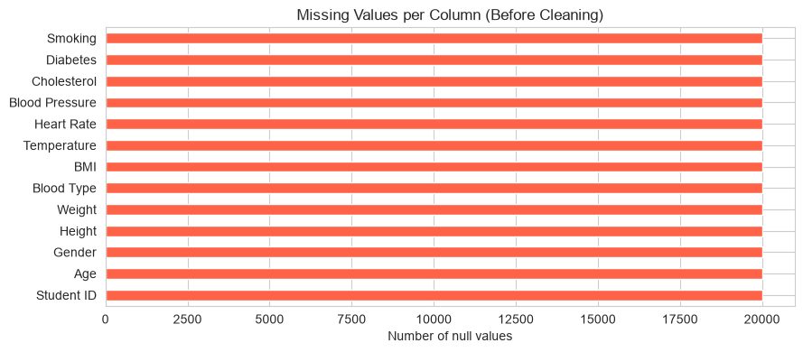
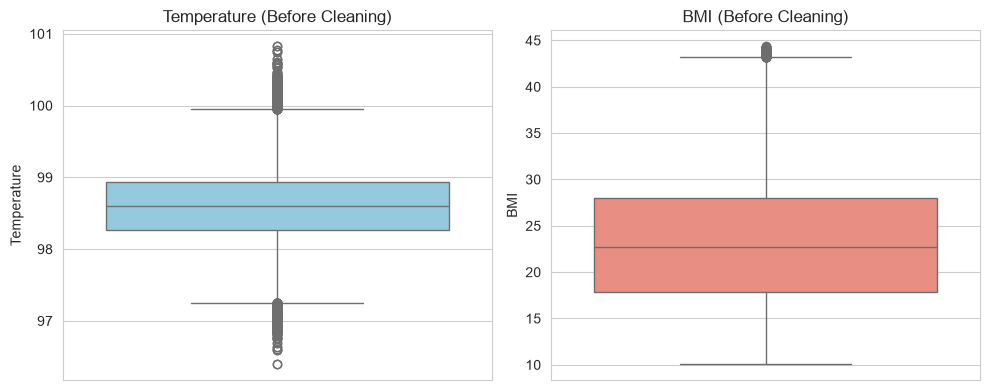
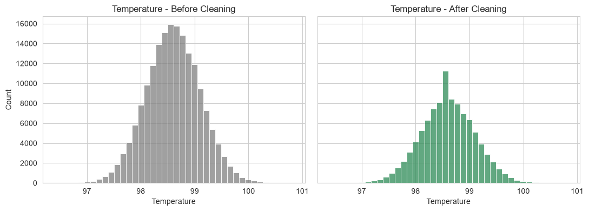

# Cleaning Data: Medical Students Dataset

**Track:** Data Analytics | **Level 1 - Task 3 (Cleaning Data)**
**Intern:** Mansi Devganiya | Oasis Infobyte SIP

## Project Overview
This project takes a deliberately messy medical dataset and turns it into a clean, analysis-ready dataset. Every cleaning decision is explained in the notebook, together with a before vs after summary.

## Dataset
- **Source:** Medical Students Dataset (Kaggle)
- **Size:** 200,000 rows and 13 columns
- **Columns:** Student ID, Age, Gender, Height, Weight, Blood Type, BMI, Temperature, Heart Rate, Blood Pressure, Cholesterol, Diabetes, Smoking
- **Note:** The file actually holds 100,000 students, each stored twice, with about 10% of the values missing at random in each copy.

## Tools Used
Python, pandas, numpy, matplotlib, seaborn, Jupyter Notebook

## Data Quality Problems Found
- 260,000 missing values (exactly 10% in every column)
- 7,644 exact duplicate rows
- 81,024 repeated Student IDs (the same student in more than one row)
- 5 columns stored with the wrong data type (Student ID, Age, Heart Rate, Blood Pressure, Cholesterol were float)
- 1,301 Temperature and 186 BMI values flagged as outliers by the IQR method

## Cleaning Steps
1. **Standardise text:** trimmed spaces and unified capitalisation. No values needed changing.
2. **Remove exact duplicates:** 7,644 rows removed.
3. **Drop rows with a missing Student ID:** 19,891 rows dropped, because an identifier cannot be estimated.
4. **Combine rows of the same student:** first checked that the two rows never conflict, then kept the first non-null value of each column. This gave 98,976 unique students.
5. **Recover values with the BMI formula:** BMI = Weight / Height squared. Recovered 2,233 BMI, 2,189 Weight and 2,248 Height values exactly.
6. **Fill remaining missing values:** median for numeric columns, "Unknown" category for categorical columns (safer than guessing medical facts such as Diabetes or Smoking).
7. **Correct data types:** whole-number columns converted to integer, text columns to category.
8. **Outliers:** Temperature and BMI outliers were kept because they are medically plausible values.

## Before vs After

| Metric | Before | After |
|---|---|---|
| Rows | 200,000 | 98,976 |
| Columns | 13 | 13 |
| Total null values | 260,000 | 0 |
| Duplicate rows | 7,644 | 0 |
| Repeated Student IDs | 81,024 | 0 |
| Columns with wrong data type | 5 | 0 |

## Limitations
- Median filling creates a small spike at the median value (visible in the Temperature histogram).
- The dataset had no inconsistent text formats (such as "male" / "M") and no date columns, so those cleaning steps found nothing to fix.

## Screenshots

## Output Files
- `cleaning_data.ipynb`: full notebook with code, charts and explanations
- `dirty_dataset.csv`: original messy dataset
- `cleaned_dataset.csv`: cleaned dataset produced by the notebook

## How to Run
1. Download this folder.
2. Install the libraries: `pip install pandas numpy matplotlib seaborn jupyter`
3. Open `cleaning_data.ipynb` and run all cells. The CSV file must stay in the same folder as the notebook.
