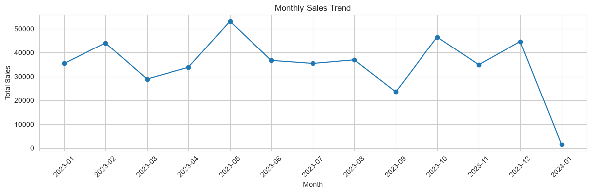
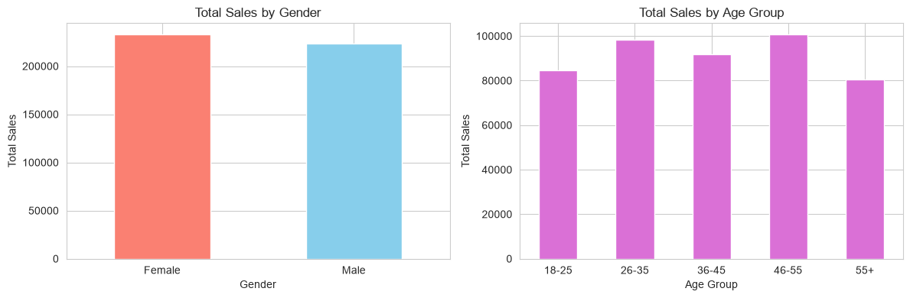
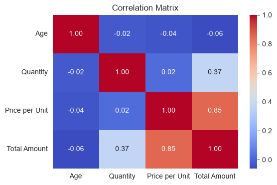

# EDA on Retail Sales Data

**Track:** Data Analytics | **Level 1 - Task 1**
**Intern:** Mansi Devganiya | Oasis Infobyte SIP

## Project Overview
This project performs Exploratory Data Analysis (EDA) on a retail sales dataset to understand sales trends, customer behaviour and product performance, and to give actionable business recommendations.

## Dataset
- **Source:** Retail Sales Dataset (Kaggle)
- **Size:** 1,000 transactions, 9 columns
- **Period:** January 2023 - January 2024
- **Columns:** Transaction ID, Date, Customer ID, Gender, Age, Product Category, Quantity, Price per Unit, Total Amount
- **Note:** The dataset has no product names, only 3 categories (Beauty, Clothing, Electronics). So each combination of Product Category and Price per Unit was treated as a product tier for the "Top 10 products" analysis. January 2024 has only one day of data and was excluded when comparing months.

## Tools Used
Python, pandas, numpy, matplotlib, seaborn, Jupyter Notebook

## Analysis Performed
1. Data loading and inspection (shape, data types, null values, duplicates)
2. Descriptive statistics (mean, median, mode, standard deviation)
3. Time series analysis (monthly and quarterly sales)
4. Customer demographics (gender and age group)
5. Product analysis (top 10 product tiers, revenue by category)
6. Correlation heatmap
7. Additional analysis: high-price vs low-price items
8. Conclusion and recommendations

## Key Insights
- Total sales were about 456,000 across 1,000 transactions. The average order value is 456, but the median is only 135, so the distribution is right skewed.
- Sales peaked in May 2023 (53,150), and Q4 2023 was the strongest quarter (126,190).
- Female (51.1%) and male (48.9%) customers contribute almost equally. Younger customers have a higher average order value (500.3 for ages 18-25 vs 412.4 for 55+).
- Electronics is the top category (34.4% of revenue), followed by Clothing (34.1%) and Beauty (31.5%).
- Price per Unit is the main driver of sales (correlation 0.85). High-priced items (300+) are only 39.6% of transactions but generate 88.4% of revenue.

## Recommendations
1. Focus on premium products, and bundle low-priced items with them to increase order value.
2. Target younger customers and increase stock and marketing before October-December. Investigate the weak Q3.
3. Grow the Beauty category through targeted offers and cross-selling.

## Screenshots

## How to Run
1. Download this folder.
2. Install the libraries: `pip install pandas numpy matplotlib seaborn jupyter`
3. Open `retail_sales_eda.ipynb` and run all cells. The CSV file must stay in the same folder as the notebook.

