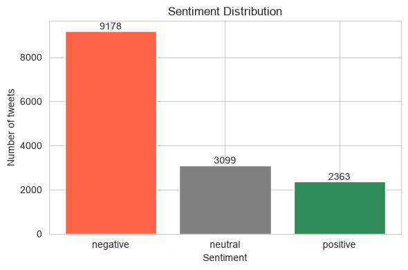
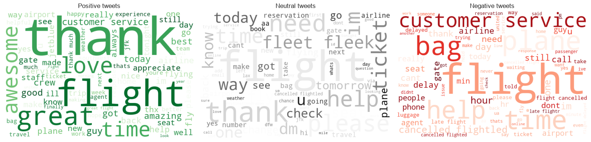
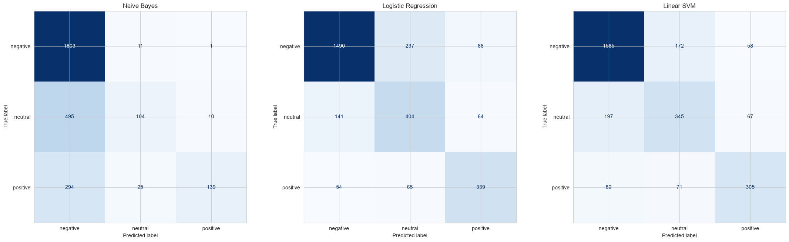
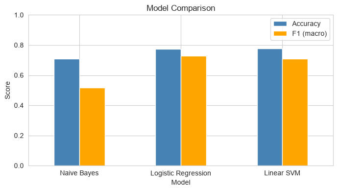

# Sentiment Analysis: US Airline Tweets

**Track:** Data Analytics | **Level 1 - Sentiment Analysis**
**Intern:** Mansi Devganiya | Oasis Infobyte SIP

## Project Overview
This project builds machine learning models that classify the sentiment of airline tweets as positive, negative or neutral, compares three models and analyses where the best model makes mistakes.

## Dataset
- **Source:** Twitter US Airline Sentiment (Kaggle)
- **Size:** 14,640 tweets, 15 columns (only the tweet text and the sentiment label are used)
- **Classes:** negative 9,178 (62.7%), neutral 3,099 (21.2%), positive 2,363 (16.1%). The classes are imbalanced.

## Tools Used
Python, pandas, NLTK, scikit-learn, WordCloud, matplotlib, seaborn, Jupyter Notebook

## Steps
1. Data loading, null check and class distribution
2. Text preprocessing: duplicate removal (213 tweets), lowercase, removal of links, mentions, numbers and punctuation, tokenisation, stopword removal (negation words such as "not" were kept) and lemmatization. 19 tweets that became empty were removed, leaving 14,408 tweets.
3. Word clouds for each sentiment class
4. TF-IDF features (single words and word pairs) with an 80/20 stratified train/test split (11,526 training and 2,882 test tweets)
5. Training and evaluation of Naive Bayes, Logistic Regression and Linear SVM (accuracy, precision, recall, F1 and confusion matrices)
6. Most important words per class, and error analysis of misclassified tweets

## Results

| Model | Accuracy | Macro precision | Macro recall | Macro F1 |
|---|---|---|---|---|
| Naive Bayes | 0.710 | 0.788 | 0.489 | 0.518 |
| Logistic Regression | 0.775 | 0.716 | 0.741 | **0.727** |
| Linear SVM | 0.776 | 0.715 | 0.702 | 0.708 |

**Best model: Logistic Regression** (highest macro F1). Because the classes are imbalanced, macro-averaged metrics are used and Logistic Regression and Linear SVM were trained with balanced class weights.

## Key Insights
- Naive Bayes finds 99.3% of negative tweets but only 17.1% of neutral and 30.3% of positive tweets, so it leans heavily towards the majority class.
- Logistic Regression is more balanced: recall is 82.1% for negative, 66.3% for neutral and 74.0% for positive tweets.
- Neutral is the hardest class (F1 of 0.614 for Logistic Regression), because neutral tweets share words with both positive and negative tweets.
- Top words for negative tweets include "hour", "delayed", "worst", "bag", "luggage" and the negations "not" and "no". Top words for positive tweets include "thanks", "great", "love" and "awesome".
- 649 of the 2,882 test tweets (22.5%) were misclassified, mostly neutral tweets, tweets with implied sentiment and tweets without strong keywords.

## Real-World Application
An airline's customer-service team could use this model to flag negative tweets automatically (precision 0.884, recall 0.821 for the negative class) so that unhappy customers get a quick reply, and to track sentiment over time or by topic.

## Limitations
- Accuracy of about 77% means roughly 1 in 4 tweets is misclassified.
- The data covers only airline tweets, so the model may not work well on other topics.
- Emojis and smileys were removed during cleaning, although they carry sentiment.
- A bag-of-words model cannot understand sarcasm or context. Possible improvements are keeping emojis and using transformer models such as BERT.

## Screenshots

## Files
- `sentiment_analysis.ipynb`: full notebook with code, charts and explanations
- `Tweets.csv`: the dataset used (Twitter US Airline Sentiment)

## How to Run
1. Download this folder.
2. Install the libraries: `pip install pandas numpy matplotlib seaborn scikit-learn nltk wordcloud jupyter`
3. Open `sentiment_analysis.ipynb` and run all cells. The CSV file must stay in the same folder as the notebook.
